## ⚡ BOOT SEQUENCE

## 🛠️ TECH ARSENAL

  

## 🚀 PROJECT LAB

### 🧠 AI & Vision

<table align="center">
<tr>
<td align="center">

</td>
<td align="center">

</td>
</tr>
<tr>
<td align="center">

</td>
<td align="center">
<!-- SPARK ka card: SPARK-REPO-NAAM ki jagah asli repo naam daalo, phir ye comment hata do

-->
</td>
</tr>
</table>

### 🌐 IoT & Smart Systems

<table align="center">
<tr>
<td align="center">

</td>
<td align="center">

</td>
</tr>
<tr>
<td align="center">

</td>
<td align="center">

</td>
</tr>
</table>

### 🛡️ Safety

> 💡 Cards ki description repo ke **About** section se aati hai. Har repo mein 1 line likh do.

## 🎯 CURRENT MISSION

| 🔵 Building | 🟦 Learning | 🩵 Exploring |
|:---:|:---:|:---:|
| **SPARK** assistant | Edge AI & TinyML | Computer Vision |
| IoT safety systems | Embedded C | Smart devices |

## 📊 PERFORMANCE HUD

## 📡 CONTACT

